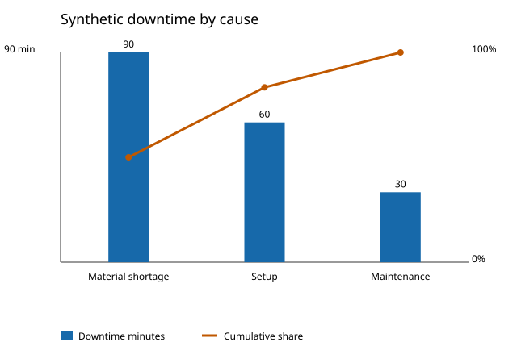

# Synthetic production OEE and downtime report

All values come from the synthetic CSV. No real plant or MES/SCADA data was used.

## Totals and definitions

- Planned time: 1440 min; downtime: 180 min; operating time: 1260 min.
- Ideal cycle: 60 s/unit; total units: 1095; good units: 1057.
- Availability = operating / planned.
- Performance = total units × ideal cycle seconds / (operating minutes × 60).
- Quality = good units / total units.
- OEE = Availability × Performance × Quality.

| Metric | Result |
| --- | ---: |
| Availability | 87.50% |
| Performance | 86.90% |
| Quality | 96.53% |
| OEE | 73.40% |

## Downtime Pareto

| Rank | Cause | Minutes | Share | Cumulative |
| ---: | --- | ---: | ---: | ---: |
| 1 | Material shortage | 90 | 50.00% | 50.00% |
| 2 | Setup | 60 | 33.33% | 83.33% |
| 3 | Maintenance | 30 | 16.67% | 100.00% |

Interpret OEE only with these definitions and the stated ideal cycle. The cause rank identifies where this synthetic dataset records the most downtime; it is not a validated plant decision.
